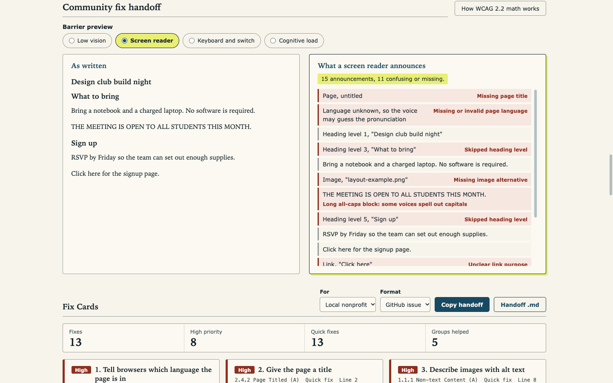
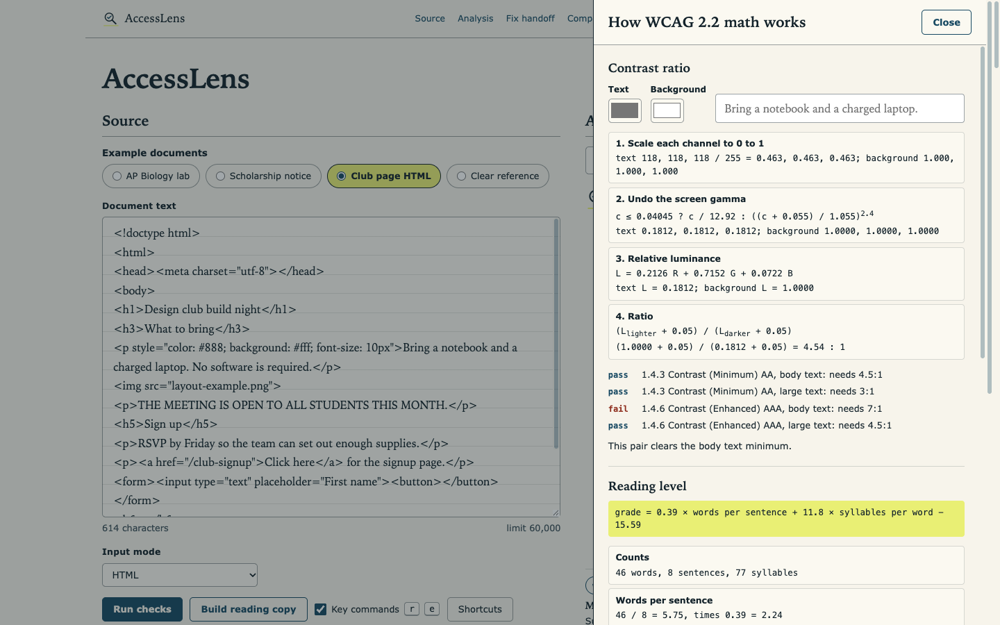

# AccessLens

AccessLens is a document inspection and reading studio for students and educators. Paste plain text or HTML, check the source, and review a proposed reading copy before sharing it. Every key point, term and flashcard can be traced back to the original.

**Live demo:** [https://aariv.me/accesslens/](https://aariv.me/accesslens/)

## Run locally

Requirements: Node.js 22 or later and a current browser. No install or internet connection is needed.

```sh
npm start
```

Open the loopback URL printed by the server. The same static files can be hosted over HTTPS under a subdirectory. A hosted copy needs its files loaded once before it can work in a disconnected tab; use the local server for a cold start with no internet. Pasted content and review state stay in memory and disappear on reload. Downloads are explicit. The evaluation JSON includes the pasted source, so review it before sharing.

## Try the studio

1. The AP Biology example is already checked when the page opens. Load **Club page HTML** or paste a document. Select its input mode and run the checks. Picking an example writes a `#lens=` hash to the address bar; opening that URL later reloads the same example, and nothing else is stored.
2. Open a flagged item to select its original source. Use the key points to find important sentences, not to replace a full read.
3. Build a reading copy. Compare the actual change in estimate and check count. Read the manual review notes before exporting.
4. Check the WCAG 2.2 audit below the comparison: eight metrics side by side, sentence-length histograms, and a badge row covering reading level, stylesheet contrast and the cognitive-load signal.
5. Switch the preview profile. Dyslexia spacing applies the WCAG 1.4.12 minimums to the papers, High contrast reports the computed ratio against AAA, and Reader outline shows the heading and glossary structure a screen reader announces.
6. Export the audit certificate in JSON, CSV or Markdown. Paste its text into the fingerprint checker to confirm it was not edited after export.
7. Reveal and rate a study card. Export Anki-compatible text or an SM-2 review CSV. Download the separate print sheet and print it from the browser.
8. Run the in-page self-tests to re-verify the shipped math in your own browser.
9. In Community fix handoff, switch barrier previews, pick who the fixes are for and the format, then copy or download the handoff. Open WCAG math to see how each threshold is computed.

The other examples are a fictional AP Biology classroom activity, a fictional scholarship notice, and a simple library guide. The single-letter `R` and `E` shortcuts are off by default. When enabled, they run the checks and focus the source editor; they do not intercept typing in controls.

## Community fix handoff

Many local nonprofits, schools and clubs run their sites on volunteer time. The handoff section turns one check into something a student volunteer or club webmaster can hand over.

- **Barrier preview.** Beside the document as written, the same content as four groups meet it: blurred and enlarged for low vision, the announcement order a screen reader produces (page title, language, headings, images, links, fields, buttons, frames), the Tab order a keyboard or switch user steps through, and a cognitive-load view where words past the 25-word sentence limit fade and words outside the common vocabulary are marked. Problem lines carry the audit finding that causes them.
- **Fix Cards.** Findings are grouped by fix and ranked by WCAG 2.2 level (A first, then AA, then AAA and reading heuristics). Each card names the success criterion, who it blocks, the source lines, the effort and the fix in plain words, with a button that selects the source.
- **Handoff text.** One click copies the cards as a GitHub issue with task boxes, an email to a nonprofit, school or club, or a printable checklist grouped by effort. The same text downloads as Markdown.
- **How WCAG 2.2 math works.** A drawer walks through the contrast ratio step by step (channel scaling, gamma, relative luminance, ratio) for any two colors with a suggested passing shade, the Flesch-Kincaid grade with this document's own counts, the 2.5.8 Target Size (Minimum) rule with live sliders including the 24 px spacing exception, and the 1.4.12 text spacing minimums. Every number comes from the same functions the audit ships, and unit tests check that they agree.

The previews approximate what assistive technology does; they do not replace testing with a real screen reader, keyboard and people who use them.





## What the scores mean

- **TextRank** builds a symmetric cosine graph with raw term counts and smoothed inverse document frequency `ln((1 + N)/(1 + df)) + 1`. Weighted PageRank uses damping `0.85`, redistributes dangling mass uniformly, and stops when the L1 change is at most `1e-6` or after 500 iterations. Only the first 400 sentences enter the graph; text metrics still cover the accepted document.
- **Readability** uses the published Flesch-Kincaid and SMOG equations with estimated English syllables and sentence boundaries. SMOG needs at least 30 sentences. The Dale-Chall proxy uses the equation with an explicitly smaller classroom list, not the published word list. Estimated reading time uses 200 words per minute.
- **Auditing** uses a tokenizer that never creates a DOM from pasted HTML. The 12 checks cover page language, title, heading jumps, empty headings, image alternatives, link purpose, control labels, button names, frame titles, inline hex contrast, uppercase passages and tiny inline text. The last two are reading heuristics; several other checks are signals, not conformance decisions.
- **Contrast** uses WCAG sRGB relative luminance and unrounded threshold decisions for supported opaque foreground/background pairs. It does not compute page styles or guess contrast across unsupported backgrounds.
- **WCAG audit** adds the published Gunning Fog equation, long-word and jargon density shares, and a sentence-length histogram whose over-25-word flag is a readability heuristic, not a WCAG rule. The SC 3.1.5 badge treats grade 9 or below as lower secondary and requires every available estimate to pass. Contrast badges apply the same luminance math to the reading stylesheet at the published AA and AAA thresholds. The 1.4.12 check measures the dyslexia profile against the published spacing minimums. All of these are signals for supported, declared values, not conformance certification.
- **Profiles** only restyle the preview. Dyslexia spacing is the fixed 1.4.12 set (letter 0.12em, word 0.16em, line 1.55, paragraph spacing 2em of font size). High contrast swaps the paper palette for ink on white and reports the computed ratio. Reader outline shows heading nesting and glossary terms; it approximates announcement order but is not a screen reader.
- **Remediation** creates a new text-first artifact with repaired headings, high-contrast reading styles, conservative substitutions, selected sentence splits and a separate checklist. It does not edit original source HTML, guess missing alternative text, or retain interactive elements. Clearer wording can increase the grade estimate.
- **Evidence** uses original UTF-16 character ranges `[start, end)`, as used by the source editor. A range may include intervening markup or entity spelling. A missing root element has no character to select.
- **Exports** include inert reading HTML, Anki Basic TSV with cloze-style blanks, quote-escaped and formula-protected CSV, a compact print sheet, a canonical JSON bundle, and the audit certificate in JSON, CSV and Markdown. The certificate fingerprints its canonical payload with a dependency-free SHA-256 implementation and stores source hashes, never source text. Pasting a certificate back recomputes the hash; a mismatch means the payload changed. It is a tamper check, not a signature.
- **Self-tests** run the same modules the page ships: FIPS 180-4 SHA-256 known answers, the `#000`/`#fff` 21:1 luminance constant, readability determinism and bounds, histogram conservation, CSV formula protection, certificate tamper detection and the non-worsening remediation invariant. Passing them is a regression signal, not a WCAG claim.

## Reproduce the evidence

```sh
nice -n 15 npm test
npm run eval:check
npm run browser:check
```

The last command requires locally installed Chrome. It is independent of the app and writes screenshots to `docs/`.

| Frozen synthetic task | Measure |
| --- | --- |
| Term spans, 10 cases | 15 true positives, 2 false positives, 1 false negative. Precision 88.2%, recall 93.8%, F1 90.9%. |
| Accessibility spans, 16 cases | 17 true positives across all 12 check IDs, no false positives or false negatives **in these fixtures**. |
| Key sentence overlap, 6 cases | TextRank 13/18 (72.2%), lead-three 8/18 (44.4%). |

See `scripts/evaluation-corpus.mjs` for the independent hand labels and `docs/evaluation.json` for per-case scores and the corpus fingerprint. This small synthetic suite is a regression benchmark, not evidence of classroom or population-level performance.

## Eight known failure modes

1. **Unlisted technical terms.** The finite vocabulary misses `phototaxis` in the benchmark. An unmarked term is not necessarily simple.
2. **Ambiguous capitals.** The detector can label a surname or heading word as an acronym. Unknown matches receive no invented expansion. Even known expansions can be ambiguous outside the example domains.
3. **Rare critical instructions.** Similarity can push an isolated warning down the ranking, including the hot plate warning in the synthetic suite. Never use the top three as a safety checklist.
4. **Readability proxies.** Grade levels do not measure individual comprehension, dyslexia, language proficiency or educational outcomes. Syllable estimates miss irregular words; non-English prose is outside the formulas' intended use.
5. **Grammar ambiguity.** The passive pattern can confuse an adjective with a participle. A proposed split may change emphasis. The studio does not do unrestricted rewriting.
6. **No computed rendering.** Stylesheets, CSS variables, images behind text, alpha blending, unsupported CSS units, and browser defaults are not measured by the inline checks. Lack of a flag is not proof of contrast or WCAG conformance.
7. **Source parsing limits.** This tokenizer does not implement the HTML living standard's tree recovery, complete entity table or accessible name algorithm. Deep nesting stops at 96 levels; inputs above 60,000 UTF-16 code units must be split. Use a real browser and assistive technology for a full audit.
8. **Loss of structure in the reading copy.** Forms, destinations, media, and table relationships are not rebuilt. Verify meaning, names, locale and required actions against the original. Use the reading copy as an editorial draft, not a drop-in web replacement.
